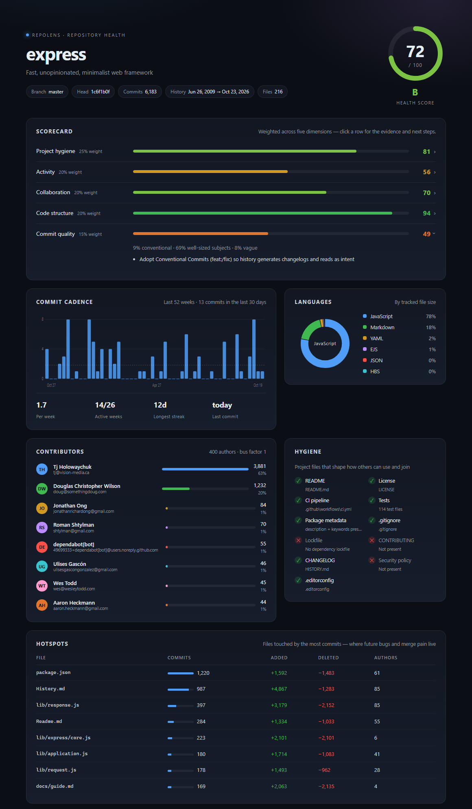

# RepoLens

**One command. A health report for any git repository.**

RepoLens reads a repository's history and working tree, scores it across five dimensions, and writes a single self-contained HTML report — plus a badge and machine-readable JSON for CI.

[](https://www.npmjs.com/package/repolens-cli)
[](https://github.com/feng540/repolens/actions/workflows/ci.yml)
[](LICENSE)
[](package.json)



```bash
npx repolens-cli .
```

## Why this exists

Dashboards exist for published packages and hosted repository analytics. What most projects don't have is a **local answer to "how healthy is this repo, really?"** that works offline, needs no account, and produces something you can attach to a review.

- **No setup.** No token, no network call, no telemetry. Point it at a clone.
- **One file out.** The report inlines its CSS and SVG — no CDN, no JavaScript. Commit it, email it, screenshot it.
- **Actionable.** Every dimension lists the evidence behind its score and the next move, not just a number.

## What it measures

| Dimension | Weight | Signals |
| --- | ---: | --- |
| **Project hygiene** | 25% | README, license, CI config, tests, package metadata, .gitignore, lockfile, CONTRIBUTING, CHANGELOG, security policy, .editorconfig |
| **Activity** | 20% | commits in the last 30/90 days, share of active weeks, streaks, recency |
| **Collaboration** | 20% | contributor count, top-author share, bus factor |
| **Code structure** | 20% | test presence, largest file, hotspot concentration, TODO/FIXME count |
| **Commit quality** | 15% | conventional-commit rate, subject length, vague subjects |

The score is a conversation starter, not a verdict. A stable library with two commits a year is not unhealthy — the report says so, in words, under each number.

## Usage

```bash
npx repolens-cli                          # scan the current directory
npx repolens-cli ~/code/express           # scan another repository
npx repolens-cli . --badge badge.svg      # also write an SVG badge
npx repolens-cli . --open                 # open the report when finished
npx repolens-cli . --json                 # machine-readable metrics
npx repolens-cli . --min 70               # exit 1 when the score is below 70
```

| Option | Description |
| --- | --- |
| `-o, --out <file>` | HTML report path (default `report.html`) |
| `-b, --badge <file>` | also write an SVG badge |
| `-j, --json` | print raw metrics as JSON |
| `--limit <n>` | commits to analyse (default 5000) |
| `--min <score>` | exit code 1 when the health score is lower |
| `--open` | open the report in the default browser |
| `--no-color` | plain terminal output |

Exit codes: `0` success, `1` not a repository / below `--min`.

## In CI

```yaml
- run: npx repolens-cli . --out report.html --min 70
- uses: actions/upload-artifact@v4
  with:
    name: repolens-report
    path: report.html
```

`--json` is stable enough to feed a badge service or a dashboard:

```bash
npx repolens-cli . --json | jq '{total, grade, dimensions: [.dimensions[] | {key, score}]}'
```

## Badge

```bash
npx repolens-cli . --badge badge.svg
```

```md
[](./report.html)
```

The badge is a plain SVG with no external references, so it renders on GitHub, in READMEs and in docs sites.

## How the score works

Each dimension is scored 0–100, then weighted: hygiene 25%, activity 20%, collaboration 20%, structure 20%, commit quality 15%.

| Total | Grade |
| ---: | :---: |
| 90+ | A+ |
| 80–89 | A |
| 70–79 | B |
| 60–69 | C |
| 50–59 | D |
| < 50 | E |

Thresholds are deliberately forgiving of small, young or deliberately-quiet projects: activity rewards consistency over volume, and collaboration rewards a documented path for outsiders more than raw contributor count.

## Design principles

- **Local first.** Everything comes from `git` and the working tree. No API keys, no rate limits, no data leaves the machine.
- **Fast.** One `git log` call carries the whole history; a 6,000-commit repository is analysed in about two seconds.
- **Boring output.** A single HTML file with inline CSS and SVG. It opens in any browser, prints cleanly, and still works in five years.
- **Honest numbers.** Every score is shown next to the evidence that produced it.

## Development

```bash
npm install
npm test          # builds, then runs the node:test suite
npm run build     # tsc -> dist/
npm run report    # dogfood: scan this repository
```

The codebase is small on purpose: `src/git.ts` (history), `src/scan.ts` (metrics collection), `src/metrics.ts` (scoring), `src/report/` (HTML + badge rendering), `src/cli.ts`.

## Roadmap

- [ ] `--compare <ref>` to diff two snapshots over time
- [ ] shields.io endpoint JSON
- [ ] GitHub Action wrapper
- [ ] Report themes

## License

[MIT](LICENSE)
